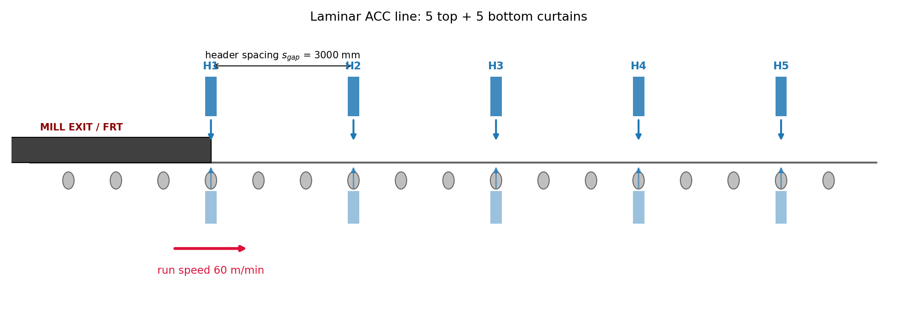
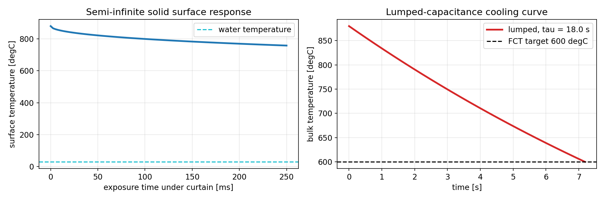
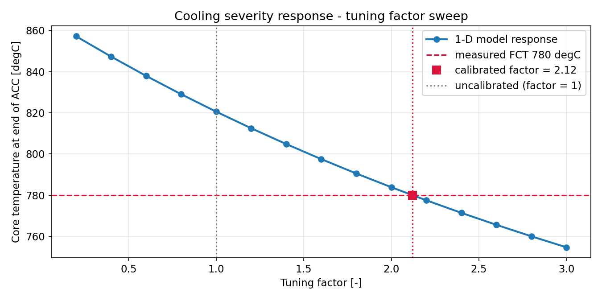
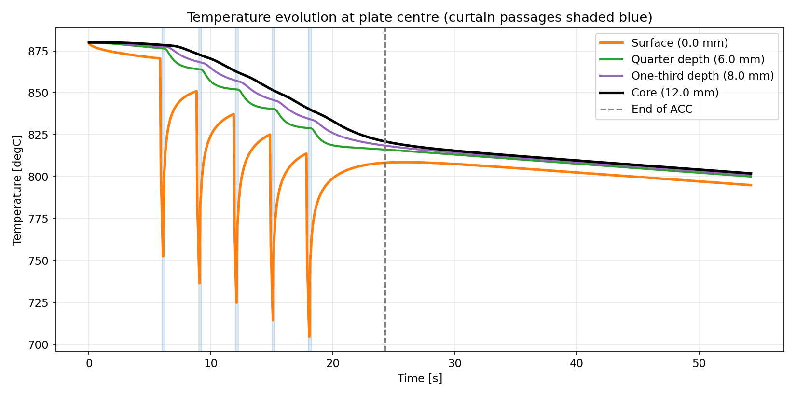
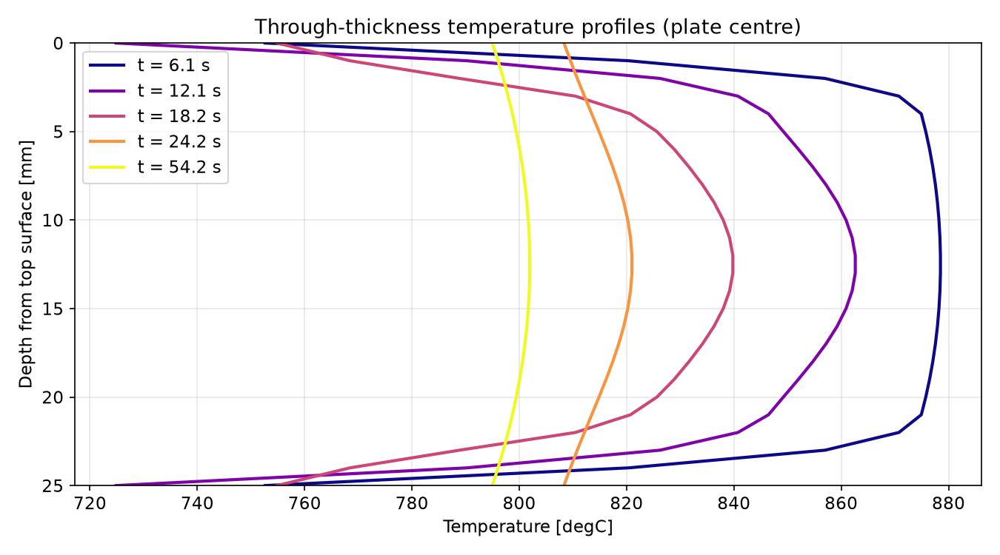
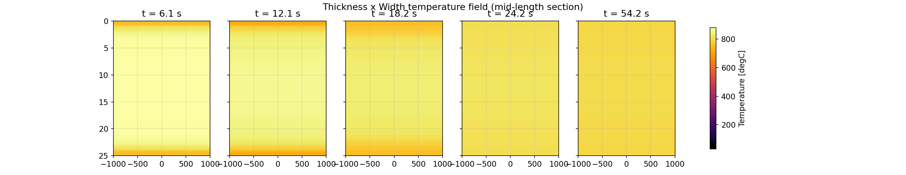
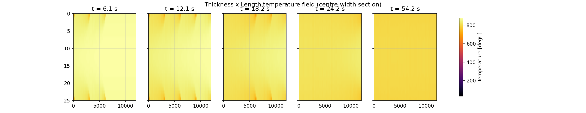
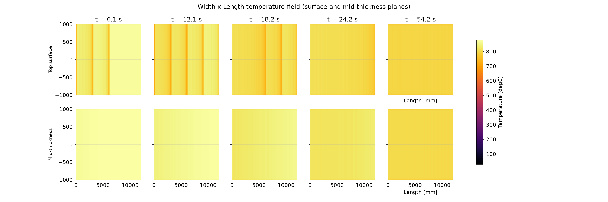
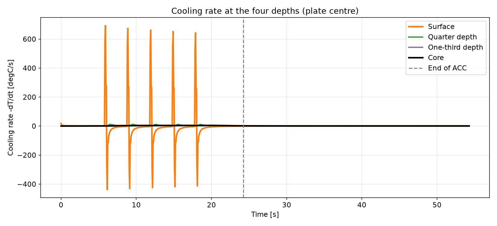
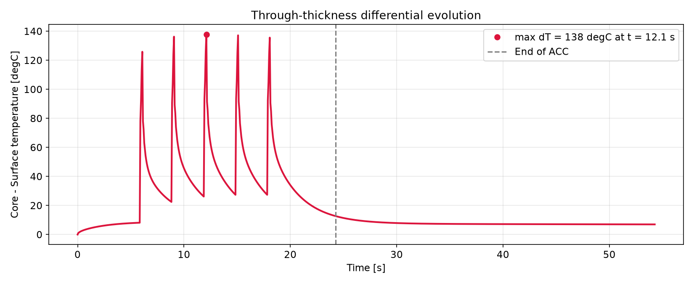

# Accelerated Cooling (ACC) of hot-rolled plates

## Empirical calculation and a 3-D finite difference heat transfer analysis

This document follows a hot-rolled steel plate from the finishing mill to the cooling bed and
answers one question: how different are the temperatures at the surface, at quarter depth (1/4),
at one-third depth (1/3) and at the core, during and after Accelerated Cooling?

The companion Colab notebook `ACC_Heat_Analysis.ipynb` implements everything described here.
The figures were produced by the notebook and saved to `figures/`.

The journey:

1. The plate leaves the finish rolling mill at the finish rolling temperature (FRT).
2. It travels down the run-out table at the table run speed, passing under laminar water
   curtains, `n_cur` headers on top and `n_cur` on the bottom, spaced `s_gap` apart along the
   table.
3. Each curtain impinges a strip of cooling water onto the plate. Between curtains, and after
   the last one, the plate cools slowly by air convection and radiation.
4. Water cooling is fierce, of order thousands of W/m²K, while steel conducts heat slowly
   (α ≈ 6×10⁻⁶ m²/s), so the surface cools far faster than the core and a through-thickness
   gradient builds.
5. An empirical module pre-calculates the water flux, the heat transfer coefficient, the Biot
   number and three analytical estimates: lumped capacitance, semi-infinite solid and Heisler
   one-term.
6. A 3-D explicit finite difference (FDM) solver resolves the full transient field
   `T(thickness, width, length, t)` with the moving-curtain boundary condition, and slices the
   field in every direction.

---

## 1 · The physics: transient heat conduction

### 1.1 Fourier's law of conduction

$$q = -k\,\nabla T$$

### 1.2 The heat diffusion equation (3-D, constant properties)

$$\rho\,c_p\,\frac{\partial T}{\partial t}
= k\left(\frac{\partial^2 T}{\partial x^2}+\frac{\partial^2 T}{\partial y^2}+\frac{\partial^2 T}{\partial z^2}\right)
\quad\Longleftrightarrow\quad
\frac{\partial T}{\partial t}=\alpha\,\nabla^{2}T,
\qquad \alpha=\frac{k}{\rho c_p}$$

with the plate axes x = thickness, y = width, z = length (rolling direction).

### 1.3 Boundary conditions

Convection, Newton's law of cooling, applies under the water curtains ($T_f = T_w$) and in air
($T_f = T_\infty$):

$$-k\,\frac{\partial T}{\partial n}\bigg|_{s} = h\,\left(T_s - T_f\right)$$

Radiation (Stefan-Boltzmann) matters on hot air-exposed surfaces:

$$q_{rad}=\varepsilon\,\sigma\left(T_s^{4}-T_f^{4}\right),
\qquad \sigma = 5.670\times10^{-8}\ \mathrm{W/m^2K^4}$$

The two combine into an effective film coefficient:

$$h_{eff}=h_{conv}+\varepsilon\,\sigma\left(T_s^{2}+T_f^{2}\right)\left(T_s+T_f\right)$$

The symmetry plane at the plate centre-line in width carries zero flux, $\partial T/\partial n = 0$, so
only half the width needs to be modelled.

### 1.4 Dimensionless numbers

$$\text{Biot: } Bi=\frac{h\,(t_h/2)}{k}
\qquad\qquad
\text{Fourier: } Fo=\frac{\alpha\,t}{(t_h/2)^2}$$

Below $Bi = 0.1$ the plate behaves almost as a lumped system. For $Bi \gg 0.1$ the internal
gradients are strong and the full finite difference solution is required.

### 1.5 Analytical solutions (benchmarks for the FDM)

Lumped capacitance, exact for $Bi<0.1$:

$$\frac{T-T_\infty}{T_i-T_\infty}=\exp\!\left(-\frac{t}{\tau}\right)=\exp(-Bi\cdot Fo),
\qquad \tau=\frac{\rho c_p V}{h A}=\frac{\rho c_p (t_h/2)}{h}$$

Semi-infinite solid with a convective surface, which gives the surface response during the
short curtain contact, with $\beta = \tfrac{h}{k}\sqrt{\alpha t}$:

$$\frac{T_s-T_\infty}{T_i-T_\infty}
=\exp\!\left(\frac{h^{2}\alpha t}{k^{2}}\right)\mathrm{erfc}\!\left(\frac{h\sqrt{\alpha t}}{k}\right)$$

Heisler one-term approximation, for the mid-plane of a plate suddenly exposed to $h$ on both
faces, with $\zeta_1\tan\zeta_1 = Bi$ and $C_1 = \dfrac{4\sin\zeta_1}{2\zeta_1+\sin 2\zeta_1}$:

$$\frac{\theta_m}{\theta_i}=C_1\,\exp\!\left(-\zeta_1^{2}\,Fo\right)$$

### 1.6 Empirical correlations

Water-flux heat transfer coefficient for laminar curtain cooling of hot steel, in power-law
form with constants taken from the ACC literature:

$$h_w = C\,\dot{W}^{\,n},\qquad
\dot{W}=\frac{\dot{Q}_{header}}{W\cdot l_{imp}}\ \ [\mathrm{m^3/m^2 s}]$$

Boiling regimes, an optional toggle: above the Leidenfrost temperature the surface is
blanketed by stable film boiling (low $h$). Below it the water wets the surface and
transition or nucleate boiling gives much higher $h$.

Cooling rate:

$$CR=-\frac{dT}{dt}\ \ [\mathrm{^\circ C/s}]$$

---

## 2 · Numerical method: explicit finite differences (FTCS)

Interior node, a 3-D second difference:

$$T_{i,j,k}^{p+1}=T_{i,j,k}^{p}
+\alpha\,\Delta t\left[
\frac{T_{i+1,j,k}^{p}-2T_{i,j,k}^{p}+T_{i-1,j,k}^{p}}{\Delta x^{2}}
+\frac{T_{i,j+1,k}^{p}-2T_{i,j,k}^{p}+T_{i,j-1,k}^{p}}{\Delta y^{2}}
+\frac{T_{i,j,k+1}^{p}-2T_{i,j,k}^{p}+T_{i,j,k-1}^{p}}{\Delta z^{2}}\right]$$

Surface node, from an energy balance on a half-cell ($T_{in}$ is the first interior node):

$$\rho c_p\,\frac{\Delta x}{2}\,\frac{dT_s}{dt}
=\frac{2k}{\Delta x}\left(T_{in}-T_s\right)+h\left(T_f-T_s\right)$$

Stability criterion for the explicit scheme, with a 0.8 safety factor:

$$\Delta t \;\le\; 0.8\cdot\frac{1}{2\alpha\left(\dfrac{1}{\Delta x^{2}}+\dfrac{1}{\Delta y^{2}}+\dfrac{1}{\Delta z^{2}}\right)}$$

Moving-curtain schedule in the Lagrangian frame. The plate is fixed on the grid and header $j$
sweeps along it at the run speed. Its position at time $t$ is

$$c_j(t)=v\,t-(j-1)\,s_{gap}$$

and any surface point $x$ is water-cooled whenever $|x-c_j(t)|\le l_{imp}/2$ for some $j$.
Everywhere else the surface sees air convection and radiation. The side edges and the plate
ends also lose heat by air convection and radiation. Conduction handles everything else.

---

## 3 · Inputs

| Parameter | Symbol | Default |
|---|---|---|
| Plate thickness | `t_h` | 25 mm |
| Plate width | `W` | 2000 mm |
| Plate length | `L` | 12000 mm |
| Header curtain number (per side; N → N top + N bottom) | `n_cur` | 5 |
| Table run speed during cooling | `v` | 60 m/min |
| Finish rolling temperature (before laminar) | `FRT` | 880 °C |
| Header spacing (uniform gap between headers) | `s_gap` | 3000 mm |
| Tuning factor (water HTC scale: >1 more severe, <1 less severe) | `tune_factor` | 1.0 |

## 4 · Fixed parameters

| Parameter | Value | Unit |
|---|---|---|
| Thermal conductivity k | 30 | W/m/K |
| Density ρ | 7850 | kg/m³ |
| Specific heat cp | 650 | J/kg/K |
| Thermal diffusivity α | 5.88×10⁻⁶ | m²/s |
| Water / ambient temperature | 30 | °C |
| Emissivity ε | 0.8 | unitless |
| Air HTC (between curtains) | 20 | W/m²/K |
| Curtain impingement length | 250 | mm |
| Water flow per header | 2000 | L/min |
| Target FCT (core) | 600 | °C |
| Post-ACC air cooling time | 30 | s |

Grid refinement: 26 × 201 × 241 nodes (thickness × half-width × length).

## 5 · The run-out table at a glance

Header $j$ meets the plate leading edge at $t=(j-1)\,s_{gap}/v$. In the solver the plate stays
fixed and the curtains sweep over it.

## 6 · Empirical pre-calculation (default inputs)

| Quantity | Value |
|---|---|
| Water flux $\dot{W}$ | 66.7 L/m²/s |
| Empirical HTC $h_w = C\dot{W}^n$ ($C=1.2\times10^4$, $n=0.45$) | 3548 W/m²/K |
| Biot number $Bi$ | 1.48, so the FDM is required |
| Lumped time to reach 600 °C | 7.18 s (invalid, $Bi \gg 0.1$) |
| Semi-infinite surface after one 0.25 s curtain pass | 880 → 758 °C |
| Heisler constants $\zeta_1$, $C_1$ | 0.984, 1.152 |

## 6b · Tuning factor: matching the model to plant reality

Real ACC lines rarely behave exactly as the textbook correlations predict. Surface scale,
water pressure and flux distribution across the header, curtain alignment, plate roughness
and recalescence all shift the effective cooling severity. The tuning factor rescales every
water-side heat transfer coefficient:

$$h_{w,\,eff} = \mathrm{tune\_factor} \times h_w$$

A factor above 1 means the line cools more severely than the prediction. A factor below 1
means it cools less severely.

If you have a measured finish cooling temperature, from a core thermocouple or an exit
pyrometer, the notebook's calibration tool finds the factor that reproduces it by bisection
on a fast 1-D through-thickness solver, with the same physics and the same curtain schedule
at the plate centre. Worked example with a measured core FCT of 780 °C:

| Quantity | Value |
|---|---|
| Predicted core FCT (factor = 1.00) | 820.5 °C |
| Measured core FCT | 780 °C |
| Calibrated tuning factor | 2.12 |
| Check with calibrated factor | 780.0 °C |

Set the calibrated factor in the inputs cell, and the full 3-D run, the contours and the
differentials all carry the calibrated severity.

## 7 · The 3-D finite difference simulation

With the default inputs: 26×201×241 nodes, Δt = 0.061 s (stability-limited), 892 explicit
steps. ACC ends at t = 24.25 s, followed by 30 s of air cooling.

## 8 · Results

### Temperature evolution at the plate centre

The headline plot is the four depths against time, with blue bands marking curtain passages at
the plate centre. Each passage pulls the surface temperature down while the core barely moves.
After the last curtain, air cooling lets the temperatures converge.

### 2-D spatial temperature fields

Thickness × Width, a mid-length section. The width gradient builds from the side edges, which
lose heat to air while the curtains quench the centre.

Thickness × Length, a centre-width section. The leading edge exits the ACC first, so the
cooled front sweeps along the plate with the curtain train.

Width × Length, the top-surface and mid-thickness planes. This is the bow-wave pattern an ACC
line is known for.

### Cooling rates and the surface-to-core differential

With the default inputs the differential peaks at about 138 °C while the curtain train is
still passing, then decays during air cooling. The rates themselves, in °C/s at each depth, are
tabulated in section 11, where they are set against the transformation temperatures.

## 9 · Validation and summary (default run)

| Check | Value | Verdict |
|---|---|---|
| Biot number | 1.48 | FDM required (Bi > 0.1) |
| Tuning factor (water HTC scale) | 1.00 | uncalibrated (correlation as-is) |
| FDM core temperature at end of ACC | 821 °C | n/a |
| Lumped-capacitance estimate (continuous quench) | 251 °C | lower bound, over-predicts cooling for pulsed curtains |
| Heisler one-term estimate (continuous quench) | 435 °C | benchmark |
| Semi-infinite surface after 1 curtain | 758 °C | benchmark |
| Max core-surface differential | about 138 °C | n/a |
| Stability (min T ≥ water temp) | 761 °C | PASS |
| Surface cools faster than core | n/a | PASS |

One caveat applies to both analytical models. They assume the water HTC acts continuously over
the whole timeline, while the FDM applies it only during curtain contact, so the analytical
values bracket the FDM result. Lumped sits below it, since continuous quenching over-predicts
the cooling, and the semi-infinite solution matches the early surface behaviour.

## 10 · Chemistry: what the grade can form

The thermal model gives the cooling rate at each depth. What that rate produces is a question
about the steel, so the write-up carries the chemistry of the grade and the standard empirical
relations for the temperatures at which the transformation starts. The composition used here, in
weight percent:

| C | Si | Mn | P | S | Al | N | Cr | Mo | Ni | Cu | V | Nb | Ti |
|---|---|---|---|---|---|---|---|---|---|---|---|---|---|
| 0.09 | 0.25 | 1.45 | 0.015 | 0.005 | 0.035 | 0.006 | 0.03 | 0.005 | 0.02 | 0.02 | 0.005 | 0.035 | 0.015 |

The relations, and where they come from.

- $Ac_1 = 739 - 22C - 7Mn + 2Si + 14Cr + 13Mo - 13Ni + 20V$ (Brandis, 1975)
- $Ac_3 = 910 - 203\sqrt{C} - 15.2Ni + 44.7Si + 104V + 31.5Mo + 13.1W$ (Andrews, 1965)
- $Ar_3 = 910 - 203\sqrt{C} - 30Mn + 44.7Si - 11Cr + 31.5Mo - 15.2Ni$ (Andrews, 1965)
- $B_s = 830 - 270C - 90Mn - 37Ni - 70Cr - 83Mo$ (Steven and Haynes, 1956)
- $M_s = 561 - 474C - 33Mn - 17Cr - 17Ni - 21Mo$ (Steven and Haynes, 1956)
- $\log_{10} V_{c90} = 2.94 - 0.75\beta$, with $\beta = 2.7C + 0.4Si + Mn + 0.45Ni + 0.8Cr + 2Mo$ (Ueno and Itoh, 1988)

Which gives, for this grade:

| Quantity | Value |
|---|---|
| Carbon equivalent β | 1.84 |
| Ac1 | 728 °C |
| Ac3 | 861 °C |
| Ar3 | 816 °C |
| Bs | 672 °C |
| Ms | 470 °C |
| Vc90, rate for 90 % martensite | 37 °C/s |

$V_{c90}$ is quoted in the boron-treated form of the equation, which is the form the handbook
reproduces. A boron-free plate needs a higher rate, so read the number as a floor.

A regression that carries the cooling rate as a term also exists (Mintz, 2011: $Ar_3 = 862 -
182C - 76.1Mn + 1121S - 1804Nb + 1168Ti - 2852N_t - 0.0084\,CR$, with $CR$ in °C/min). It was
fitted between 10 and 200 °C/min and the peak rates in this run go far past that, so the notebook
prints it only where the rate falls inside the fitted range and says so where it does not.

## 11 · Reading the cooling curve against the transformation temperatures

Every depth has its own thermal path, so every depth meets the transformation temperatures at a
different moment and at a different rate. The rates, in °C/s:

| Depth | Peak | Mean over the ACC pass | While air cooling | Through 800 to 500 °C |
|---|---|---|---|---|
| Surface | 692 | 3.0 | 0.45 | not reached |
| Quarter depth | 11.7 | 2.6 | 0.54 | not reached |
| One-third depth | 6.0 | 2.5 | 0.58 | not reached |
| Core | 4.3 | 2.4 | 0.63 | not reached |

The peak is the steepest instant, under a curtain as it passes, and it is the most grid-sensitive
number in the whole model, since it follows from the water coefficient and the 1 mm first cell
rather than from a measured surface response. The mean over the pass is what the bulk of the plate
experiences. The rate while air cooling is the one that governs the transformation, because that
is the rate the plate carries by the time it reaches the transformation range. No depth reaches
500 °C inside the 54 s that are simulated, so the 800 to 500 °C window, the range that matters for
the phases, sits outside this run.

Set against the chemistry:

| Depth | Rate while air cooling [°C/s] | T at end of ACC [°C] | T at end of window [°C] | What the path implies |
|---|---|---|---|---|
| Surface | 0.45 | 808 | 795 | ferrite and pearlite; 0.45 °C/s against Vc90 = 37 °C/s rules out martensite |
| Quarter depth | 0.54 | 816 | 800 | ferrite and pearlite |
| One-third depth | 0.58 | 819 | 801 | ferrite and pearlite |
| Core | 0.63 | 821 | 802 | ferrite and pearlite |

None of that is a transformation, and the numbers say why. The section leaves the curtains between
808 and 821 °C, so the surface is already under the equilibrium Ar3 of 816 °C while the core is
just above it, and the 30 s of air cooling brings every depth under Ar3. Bs at 672 °C and Ms at
470 °C stay far below, and from there the plate sheds heat at under 0.6 °C/s against the 37 °C/s
that 90 % martensite would need, while bainite would ask for the section to reach 672 °C at a rate
it never sees. Ferrite and pearlite is what this plate can make.

The 692 °C/s surface spike is real in the model and irrelevant to the phases, because it happens
while the surface is still near 880 °C, well above the ferrite start temperature, and a cooling
rate only decides the microstructure while the steel is inside the transformation range. This is
also where the through-thickness spread goes quiet: the depths differ by about 13 °C at the end of
the ACC, against 138 °C at the peak of the pass.

What the comparison cannot do is kinetics. A threshold temperature says that a phase is possible,
not how much of it appears, because the amount depends on how long the steel sits in each
temperature range, and that is what a CCT diagram encodes. Going further honestly means a measured
CCT diagram for the grade, a calibrated transformation model, or a thermodynamic calculation in
pycalphad. pycalphad answers a different question again, since it gives the equilibrium phase
fractions against temperature, needs a steel database to do it (Thermo-Calc TCFE, or MatCalc's
iron database), and carries no kinetics either.

## 12 · The story, in short

- The surface is quenched by every curtain passage, while the core barely notices a single one
  and follows only through conduction, so the differential peaks while the curtain train is
  still passing.
- Since $Bi \gg 0.1$ the lumped model is no use for design. The FDM resolves the quarter-depth
  and one-third-depth temperatures that sit between the two extremes.
- Width and length gradients come from the side edges and from the leading and trailing edges
  losing heat to air, which shows up as cold rims in every contour.
- The cooling rate in °C/s: the surface sees a peak of about 692 °C/s as each curtain passes, the
  section as a whole cools at 2.4 to 3.0 °C/s over the ACC pass, and the rate that governs the
  transformation is the 0.45 to 0.63 °C/s of air cooling on the bed. The surface peak is the most
  grid-sensitive number in the model.
- The chemistry of the grade (C 0.09, Mn 1.45, Nb 0.035) puts $Ac_1$ at 728 °C, $Ac_3$ at 861 °C,
  $Ar_3$ at 816 °C, $B_s$ at 672 °C and $M_s$ at 470 °C, and 90 % martensite would need 37 °C/s.
  Since the section leaves the curtains between 808 and 821 °C and then cools at under 0.6 °C/s,
  the plate makes ferrite and pearlite, and bainite never gets a look in.
- Change `t_h, W, L, n_cur, v, FRT, s_gap` in the notebook's inputs cell and re-run. The whole
  pipeline, from the empirical pre-calculation through the FDM to the contours, updates by
  itself.
- When plant measurements disagree with the prediction, calibrate the `tune_factor` (section
  6b) from a measured finish cooling temperature, and every downstream result carries the
  calibrated severity.
