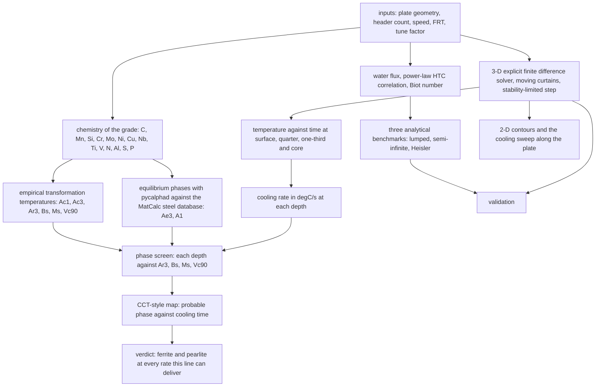

# Cooling of a hot-rolled plate on an accelerated cooling line

A transient heat transfer model of what happens to a plate between the finishing mill and the
cooling bed: how far apart the surface, quarter-depth, one-third-depth and core temperatures
get while the laminar water curtains pass, and how the plate evens out afterwards.

The question it answers is a practical one. Everyone in the mill knows the surface is colder
than the core during accelerated cooling. The problem is knowing by how much, at each depth,
at each moment, and how much of that gap survives into the cooling bed. That gap is what drives
residual stress, flatness and property gradients through the thickness.

## What is here

```
ACC_Heat_Analysis.ipynb       the model, one cell per step, runs in a few minutes
ACC_Heat_Analysis.md          the same work as a write-up, with the equations and result tables
scripts/make_schematics.py    draws the two schematics below, no solver run needed
figures/                      output of the default run, plus those schematics
```

## The line, schematically


The plate leaves the finishing mill at the finish rolling temperature and passes a bank of headers
above and below. The drawing uses a 1000 mm header spacing so that the full bank of eight headers
fits in one picture, and eight is the most this line carries per side. The default run in the
notebook is five headers spaced 3000 mm apart, so the drawing and the numbers differ on purpose:
`scripts/make_schematics.py` holds the geometry of the picture, while `n_cur` and `s_gap` in the
inputs cell drive the solution and the notebook's own schematic in section 7.

A point on the surface is under water for the short time the impingement length takes to pass, then
loses heat to air and radiation until the next header arrives, which is what the lower panel
sketches and what section 11 computes.


Half the width is solved, by symmetry, and the four depths quoted throughout are taken at the plate
centre: surface, quarter depth, one-third depth and core. The impingement band is the part of the
surface that sees the water coefficient at a given instant.

## The route



The order matters. The chemistry decides the thresholds before the thermal model produces the rates,
and the phases are read at the point where the two meet. In the notebook the sections run in that
order: inputs and the grade first, then the temperature field through the thickness, then the phase
questions.

## How it works

The cooling line is modelled in three stages.

The empirical module sizes the problem first. It computes the water flux from the header flow
and the impingement area, turns that into a heat transfer coefficient through a power-law
correlation, and reports the Biot number together with three analytical estimates: lumped
capacitance, semi-infinite solid and the Heisler one-term approximation. With the default
inputs the Biot number is 1.48, which is well above 0.1, so the lumped model is not usable for
design and a field solution is needed.

The 3-D explicit finite difference solver then resolves `T(thickness, width, length, t)` on a
26 × 201 × 241 grid with a stability-limited time step of 0.061 s. The plate stays fixed and
the curtains sweep over it: any surface point within half an impingement length of a header
sees the water coefficient, everything else sees air convection and radiation combined into a
single effective film coefficient. Half the width is modelled, by symmetry. The solver samples
the four depths at the plate centre and keeps full-field snapshots for the contour maps.

A tuning factor then calibrates the water-side coefficient against reality. Surface scale,
header pressure and flux distribution, curtain alignment, plate roughness and recalescence all
move the effective cooling severity away from the textbook correlation, so the notebook can
search for the factor that reproduces a measured finish cooling temperature. A 1-D
through-thickness solver with the same physics runs the search in seconds, and the worked
example in the write-up recovers a measured 780 °C core from a predicted 820.5 °C with a factor
of 2.12.

A last module reads the thermal result as metallurgy. It carries the chemistry of the grade, which
sits in the inputs cell beside the process settings, and works the phase question two ways: the
standard empirical relations for the transformation temperatures (Ac1, Ac3, Ar3, Bs, Ms) together
with the cooling rate that would leave 90 percent martensite, and an equilibrium calculation with
pycalphad against the open MatCalc steel database. Then it sets those thresholds against the rate
each depth actually inherits, and draws a CCT-style map of phase against cooling time. It is a
screening calculation and says so: a threshold temperature makes a phase possible, while how much
of it appears depends on the time spent in each temperature range, which is what a CCT diagram
encodes.

The ferrite start line on that map is the one relation in the notebook that carries the cooling
rate itself [8]. It was fitted between 10 and 200 °C/min, so it is drawn only over the band that
corresponds to, and where the rate leaves the band the notebook prints that the point is outside the
range instead of quoting a temperature. A surface spike of several hundred degrees per second fed to
that regression returns a number, and the number is meaningless.

## Equations

The relations are taken from the sources cited at the end of the file. Symbols are defined under
each one, and the default values are the ones in the notebook's fixed parameter cell.

### How heat moves inside the plate

$$\mathbf{q} = -k\nabla T, \qquad \frac{\partial T}{\partial t} = \alpha \nabla^2 T, \qquad \alpha = \frac{k}{\rho c_p} \qquad [1]$$

- $\mathbf{q}$ is the heat flux vector in W/m², the heat crossing a square metre of steel per second, pointing down the temperature gradient.
- $k$ is the thermal conductivity of the steel, 30 W/m/K in the default run.
- $\nabla T$ is the temperature gradient in K/m, which sets both the direction and the steepness of the flow.
- $\rho$ is the density, 7850 kg/m³, and $c_p$ the specific heat, 650 J/kg/K.
- $\alpha$ is the thermal diffusivity in m²/s, 5.88 × 10⁻⁶ here, and it is the number that decides how fast a temperature difference spreads.
- $t$ is time.

The first relation says that heat inside the plate moves from hot to cold at a rate the conductivity
fixes. The second says that nothing else moves it: no source, no sink, only conduction, and that the
diffusivity sets the pace. A 25 mm plate needs minutes to even out through the thickness, which is
why the surface and the core are still 138 °C apart when the plate leaves the curtains.

### At the surfaces

$$-k\frac{\partial T}{\partial n} = h_w\,(T_s - T_w) \qquad [2]$$

$$-k\frac{\partial T}{\partial n} = h_{air}(T_s - T_\infty) + \varepsilon\sigma\left(T_s^4 - T_{amb}^4\right) \qquad [2]$$

- $\partial T/\partial n$ is the temperature gradient perpendicular to the surface, in K/m.
- $h_w$ is the water-side heat transfer coefficient in W/m²/K, 3548 in the default run, and $h_{air}$ the air-side value, 20.
- $T_s$ is the surface temperature at that instant, and $T_w$ the cooling water at 30 °C.
- $T_\infty$ is the ambient air at 30 °C, and $T_{amb}$ the surroundings the surface radiates to.
- $\varepsilon$ is the surface emissivity, 0.8 for oxidised steel, and $\sigma$ the Stefan-Boltzmann constant, 5.670 × 10⁻⁸ W/m²/K⁴.

The first condition holds while the point sits under a curtain: the heat arriving at the surface from
inside is carried off by the water at a rate proportional to how far the surface is above the water
temperature. The second holds in the gaps and after the last curtain, where air takes part of it and
the surface radiates the rest. The radiative term grows with the fourth power of temperature, so it
dominates at 880 °C and fades as the plate cools. The symmetry plane at half width carries no flux,
$\partial T/\partial n = 0$, and the two ends of the plate lose heat to air by the second condition.

### The water side

$$\dot W = \frac{Q_{header}/60}{W\,l_{imp}}, \qquad h_w = C\,\dot W^{\,n}, \qquad C = 1.2\times10^{4},\; n = 0.45$$

- $\dot W$ is the water flux in L/m²/s: the header's volume flow spread over the area it actually wets.
- $Q_{header}$ is the flow per header, 2000 L/min, divided by 60 to reach litres per second.
- $W$ is the plate width, 2000 mm, and $l_{imp}$ the impingement length, 250 mm, the strip of surface one curtain contacts.
- $C$ and $n$ are the correlation constants.

The flux works out at 66.7 L/m²/s, which is a plausible curtain load for a plate mill. The power-law
form is ordinary forced-convection practice, but these two constants are the one place in the file
with no source I can name. They came with the original notebook rather than from a paper, so they are
a starting calibration and not a measured property of any line. The tuning factor in the tuning
section exists to absorb that difference, and a plant wanting the constant for its own headers has to
calibrate it against a measured finish cooling temperature.

### Two dimensionless numbers and three analytical answers

$$Bi = \frac{h_w\,(t_h/2)}{k}, \qquad \tau = \frac{\rho c_p (t_h/2)}{h_w}, \qquad T(t) = T_w + \left(T_{FRT} - T_w\right)e^{-t/\tau} \qquad [2]$$

- $Bi$ is the Biot number: the resistance to heat transfer at the surface divided by the resistance to conduction inside.
- $t_h$ is the plate thickness, 25 mm, and $t_h/2$ the half thickness, which is the conduction length that matters for a plate cooled from both faces.
- $\tau$ is the time constant in seconds, 18.0 in the default run.
- $T_{FRT}$ is the finish rolling temperature, 880 °C, the temperature the plate enters the cooling zone at.

The Biot number comes out at 1.48, well above 0.1, which rules out treating the plate as a single
lump. The lumped model is printed anyway because it is the fast sanity check: it predicts 251 °C at
the end of cooling against 821 °C from the field solution, and the gap is exactly the through-thickness
gradient this project is about.

$$T_s = T_{FRT} + \left(T_w - T_{FRT}\right)\left(1 - e^{b^2}\mathrm{erfc}\,b\right), \qquad b = \frac{h_w\sqrt{\alpha t}}{k} \qquad [1]$$

- $b$ is a dimensionless group that combines the water coefficient, the diffusivity and the time the surface has been wet.
- $t$ is the exposure time under one curtain, 0.25 s at 60 m/min with a 250 mm impingement band.
- $\mathrm{erfc}$ is the complementary error function.

This treats the plate as infinitely thick during a single pass, which is fair while the thermal wave
has not yet reached the core. It gives the surface response to one curtain: 880 down to 758 °C, which
is the sharp drop that appears at every header in the evolution plot.

$$\zeta_1\tan\zeta_1 = Bi, \qquad C_1 = \frac{4\sin\zeta_1}{2\zeta_1 + \sin 2\zeta_1}, \qquad \frac{T-T_w}{T_0-T_w} = C_1 e^{-\zeta_1^2 Fo}, \qquad Fo = \frac{\alpha t}{(t_h/2)^2} \qquad [3]$$

- $\zeta_1$ is the first root of the transcendental equation, 0.9836 here, and $C_1$ its coefficient, 1.1524.
- $Fo$ is the Fourier number, dimensionless time: diffusivity multiplied by time divided by the square of the half thickness.
- $T_0$ is the starting temperature and $T$ the temperature at that Fourier number.

One term of the series is enough at these Fourier numbers. It is the third estimate: 435 °C at the end
of cooling, between the lumped value and the field solution, as it should be.

### Keeping the march in time stable

$$\Delta t = 0.8 \min\left(\frac{1}{2\alpha\left(\Delta x^{-2} + \Delta y^{-2} + \Delta z^{-2}\right)},\;
\frac{1}{2\alpha/\Delta x^2 + 2h_{max}/(\rho c_p \Delta x)}\right) \qquad [4]$$

- $\Delta t$ is the time step, 0.061 s in the default run.
- $\Delta x$, $\Delta y$, $\Delta z$ are the node spacings, 1 mm across the thickness, 5 mm across the half width and 50 mm along the length.
- $h_{max}$ is the largest surface coefficient applied during the run, the water value or the film-boiling value when that toggle is on.
- The 0.8 is margin on the limit rather than the limit itself.

Explicit schemes advance the solution one small step at a time and become unstable if the step is too
long. The first term is the limit set by conduction between nodes. The second is the tighter one at a
surface, because a node that also loses heat to the fluid can change faster than conduction alone
would allow. Both are evaluated before the run starts, and the smaller one, scaled by 0.8, is used.

$$h_{rad} = \varepsilon\sigma\left(T^2 + T_\infty^2\right)\left(T + T_\infty\right) \qquad [2]$$

- $h_{rad}$ is a radiative coefficient in W/m²/K that transfers the same heat as $T^4 - T_{amb}^4$ at the current temperature.

Factoring the quartic this way turns radiation into an extra film coefficient, so the surface update
stays linear in temperature and the stability criterion above still applies. The cost is that
$h_{rad}$ has to be recomputed at every step, which is cheap and done.

### What is asked of the result

$$CR = -\frac{dT}{dt}$$

- $CR$ is the cooling rate in °C/s at a given depth, the quantity the metallurgy responds to.
- The minus sign makes it positive while the plate cools.

The rates that come out are 692 °C/s at the surface as a curtain passes, 2.4 to 3.0 °C/s averaged
over the whole cooling pass, and 0.45 to 0.63 °C/s once the plate is air cooling on the bed.

### Where the steel transforms

$$Ac_1 = 739 - 22C - 7Mn + 2Si + 14Cr + 13Mo - 13Ni + 20V \qquad [7]$$

$$Ac_3 = 910 - 203\sqrt{C} - 15.2Ni + 44.7Si + 104V + 31.5Mo + 13.1W \qquad [6]$$

$$Ar_3 = 910 - 203\sqrt{C} - 30Mn + 44.7Si - 11Cr + 31.5Mo - 15.2Ni \qquad [6]$$

$$B_s = 830 - 270C - 90Mn - 37Ni - 70Cr - 83Mo, \qquad M_s = 561 - 474C - 33Mn - 17Cr - 17Ni - 21Mo \qquad [5]$$

$$\log_{10} V_{c90} = 2.94 - 0.75\beta, \qquad \beta = 2.7C + 0.4Si + Mn + 0.45Ni + 0.8Cr + 2Mo \qquad [9]$$

- The element symbols are mass fractions in weight percent, taken from the chemistry in the inputs cell: C 0.09, Mn 1.45, Si 0.25, Nb 0.035, Ti 0.015 for the default grade.
- $Ac_1$ is where austenite begins to form on heating, and $Ac_3$ where the steel becomes fully austenitic.
- $Ar_3$ is where ferrite begins to form on cooling, so it is the temperature the plate has to fall below before anything happens.
- $B_s$ is where bainite starts and $M_s$ where martensite starts.
- $V_{c90}$ is the cooling rate that would leave 90 percent martensite, and $\beta$ the carbon equivalent the relation is built on.

For this grade the answers are $Ac_1$ 728 °C, $Ac_3$ 861 °C, $Ar_3$ 816 °C, $B_s$ 672 °C, $M_s$ 470 °C
and $V_{c90}$ 37 °C/s. The heating and cooling temperatures are not the same number for the same
steel, which is why $Ac_3$ sits 45 °C above $Ar_3$: one is measured going up and the other coming
down, with the undercooling included.

The ferrite start line on the CCT map is the one relation here that carries the cooling rate itself
[8]. It was fitted between 10 and 200 °C/min, so the notebook draws it only over that band, and where
a rate leaves the band the cell reports that rather than quoting a temperature. A surface spike of
several hundred degrees per second put into that regression returns a number, and the number would be
nonsense.

### The equilibrium calculation

$$\min G(T, x) \quad \text{over} \quad \{\gamma, \alpha, Fe_3C, M_{23}C_6, M_7C_3, M_6C\} \qquad [11]$$

- $G$ is the Gibbs energy of the system, and $T$ and $x$ are the temperature and the composition it is evaluated at.
- $\gamma$ is austenite, $\alpha$ is ferrite, and the rest are the carbide phases the calculation is allowed to use.
- The phase set that minimises $G$ at a given temperature and composition is the stable one.

pycalphad searches for that minimum [12] using the MatCalc steel database [13], [14], and the notebook
reads the boundaries off the resulting fractions. Because it is equilibrium, it has nothing to say
about how long a transformation takes, which is why it sets the thresholds and the cooling rates in
the next section decide the outcome.

## Default run

Inputs: 25 mm thick, 2000 mm wide, 12000 mm long, five curtains per side spaced 3000 mm apart,
60 m/min table speed, 880 °C finish rolling temperature.

- Core falls from 880 °C to 821 °C over 24.25 s of cooling, then the plate air-cools for 30 s.
- The surface-to-core differential peaks at about 138 °C while the curtain train is still passing,
  and the depths differ by only about 13 °C once the plate reaches the cooling bed.
- The cooling rate in °C/s: about 692 at the surface as a curtain passes, 2.4 to 3.0 averaged over
  the ACC pass, and 0.45 to 0.63 while the plate air cools. Against a chemistry of 0.09 C, 1.45 Mn
  and 0.035 Nb, the section leaves the curtains between 808 and 821 °C and transforms on the bed at
  under 0.6 °C/s, which is ferrite and pearlite. Bainite would need the plate to reach 672 °C at a
  rate it never sees, and 90 percent martensite would need 37 °C/s or more.
- The analytical estimates bracket the field solution rather than matching it, because both
  assume the water coefficient acts continuously while the real schedule is pulsed. Lumped
  capacitance gives 251 °C at the end of cooling, which is a lower bound, and Heisler gives
  435 °C.
- Stability checks pass: the minimum temperature stays above the water temperature and the
  surface cools faster than the core, as it must.

The full write-up, with the equations, the input tables and every figure, is in
`ACC_Heat_Analysis.md`.

## Methods and tools

- **numpy** for the whole numerical core: the finite difference fields, the vectorised curtain mask,
  the analytical solutions and every derived quantity.
- **matplotlib** for the twelve figures, written to `figures/` by the notebook itself.
- **The field solution is an explicit finite difference scheme** on a 26 x 201 x 241 grid with a
  stability-limited step, chosen over a commercial solver because the moving-curtain boundary
  condition and the through-thickness sampling are both easy to write directly and to check.
- **pycalphad with the MatCalc mc_fe v2.062 steel database** (ODbL, TU Wien) for the equilibrium
  annex. It needs Python 3.13 or older, since there is no `symengine` wheel for 3.14 yet, and the
  database is fetched at first use rather than committed.
- **Closed-form metallurgical relations** for the transformation temperatures, each cited at the
  point of use and each restricted to the range it was fitted over.
- **nbconvert** to execute the notebook headlessly, so the outputs that ship with it are the result
  of a run rather than of a session.

## Run it

[](https://colab.research.google.com/github/daniswaramp/accelerated_cooling_fdm/blob/main/ACC_Heat_Analysis.ipynb)

The notebook needs only `numpy` and `matplotlib`, both of which Colab already has, so the badge
above runs it without any setup. Locally:

```bash
pip install -r requirements.txt
jupyter notebook ACC_Heat_Analysis.ipynb
```

Change the process inputs and the chemistry in the inputs cell and re-run. The empirical
pre-calculation, the field solution, the contours, the cooling rates and the phase screening all
follow automatically.

The equilibrium annex in section 3 is the one part that needs something extra. It wants
`pycalphad` (`pip install pycalphad`, which currently needs Python 3.13 or older because there is
no `symengine` wheel for 3.14 yet) and fetches the MatCalc mc_fe v2.062 steel database on first
use into `databases/`, published by TU Wien under the Open Database Licence. Without pycalphad
the rest of the notebook runs and that cell reports that the annex was skipped.

## Scope

The plate is a homogeneous slab with constant thermal properties. Phase transformation latent
heat is not resolved, the boiling regime enters through the optional toggle on the water
coefficient rather than a boiling curve, and the scale layer is ignored. Those are the three
places where a plant measurement would diverge most, which is what the tuning factor exists to
absorb. Treat the default numbers as a method demonstration tuned to plausible plate-mill
conditions, not as a statement about any particular line.

## References

[1] H. S. Carslaw and J. C. Jaeger, *Conduction of Heat in Solids*, 2nd ed. Oxford, U.K.: Oxford Univ. Press, 1959.

[2] T. L. Bergman, A. S. Lavine, F. P. Incropera, and D. P. DeWitt, *Fundamentals of Heat and Mass Transfer*, 8th ed. Hoboken, NJ, USA: Wiley, 2018.

[3] M. P. Heisler, "Temperature charts for induction and constant-temperature heating," *Trans. ASME*, vol. 69, pp. 227-236, 1947.

[4] J. Crank, *The Mathematics of Diffusion*, 2nd ed. Oxford, U.K.: Oxford Univ. Press, 1975.

[5] W. Steven and A. G. Haynes, "The temperature of formation of martensite and bainite in low-alloy steels. Some effects of chemical composition," *J. Iron Steel Inst.*, vol. 183, pp. 349-359, 1956.

[6] K. W. Andrews, "Empirical formulae for the calculation of some transformation temperatures," *J. Iron Steel Inst.*, vol. 203, pt. 7, pp. 721-727, 1965.

[7] H. Brandis, "Rechnerische Bestimmung der Umwandlungstemperaturen von niedriglegierten Stählen," *TEW Tech. Ber.*, vol. 1, no. 1, pp. 8-10, 1975.

[8] B. Mintz, J. R. Banerjee, and K. M. Banks, "Regression equation for Ar3 temperature for coarse grained as cast steels," *Ironmaking & Steelmaking*, vol. 38, no. 3, pp. 197-203, 2011.

[9] M. Ueno and K. Itoh, "New empirical formula for estimation of hardenability from chemical compositions," *Tetsu-to-Hagané*, vol. 74, no. 6, pp. 1073-1080, 1988.

[10] A. A. Gorni, *Steel Forming and Heat Treating Handbook*, 27 Sep. 2024 ed. [Online]. Available: http://www.gorni.eng.br/e/Gorni_SFHTHandbook.pdf

[11] L. Kaufman and H. Bernstein, *Computer Calculation of Phase Diagrams*. New York, NY, USA: Academic Press, 1970.

[12] R. Otis and Z.-K. Liu, "pycalphad: CALPHAD-based computational thermodynamics in Python," *J. Open Res. Softw.*, vol. 5, no. 1, p. 1, 2017, doi: 10.5334/jors.140.

[13] E. Povoden-Karadeniz and A. Jacob, "MatCalc steel database mc_fe, version 2.062," TU Wien, Vienna, Austria, 2023, Open Database Licence. [Online]. Available: https://www.matcalc.at

[14] A. Moolya, "PyCalphad-compatible port of the MatCalc mc_fe v2.062 steel database," 2024. [Online]. Available: https://github.com/adityamoolya/maraging-steel-calphad
