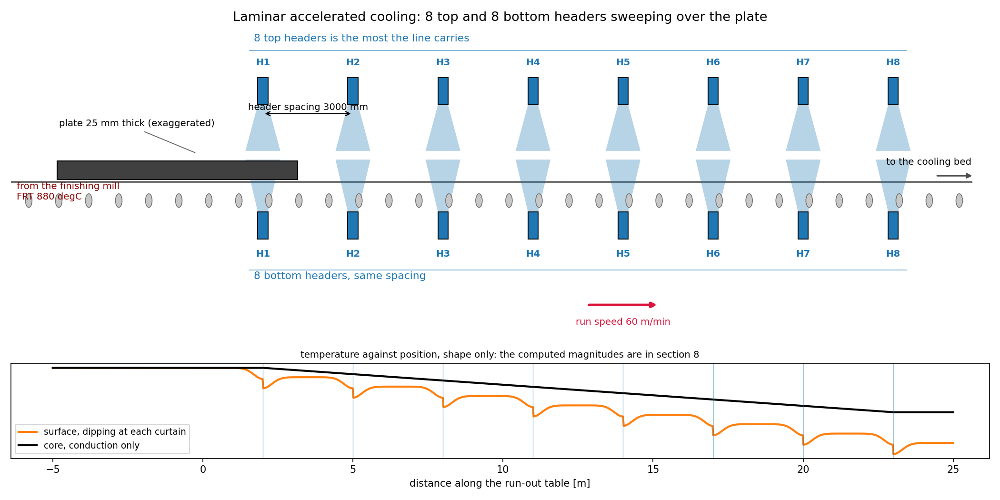
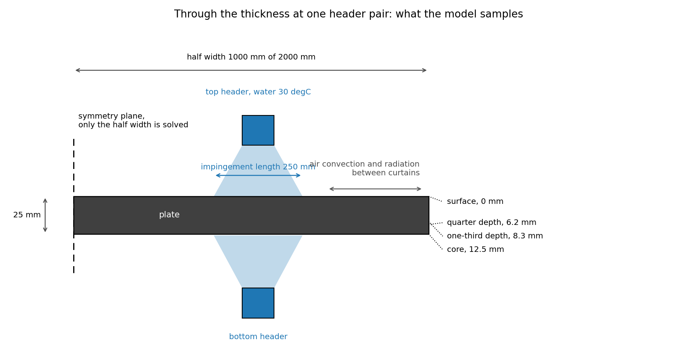
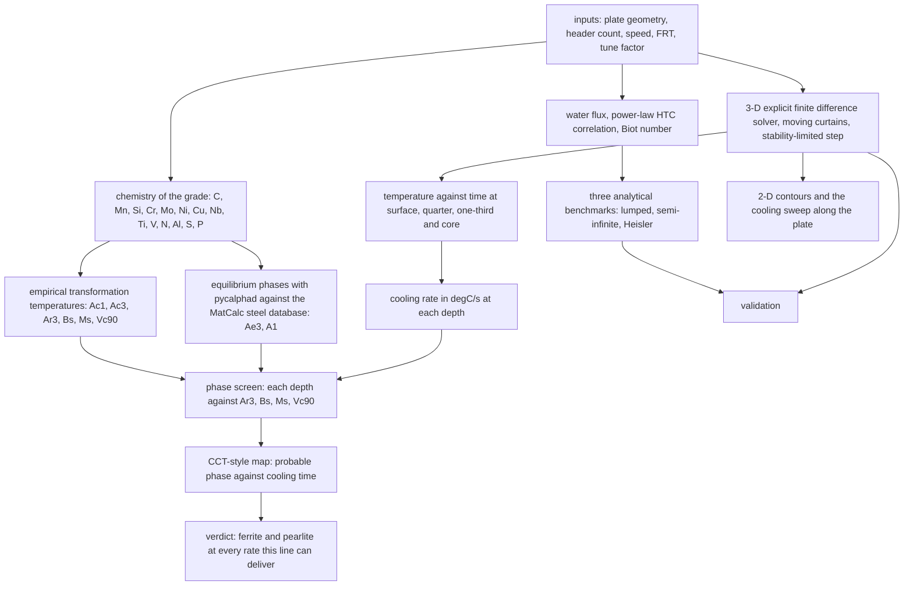

# Cooling of a hot-rolled plate on an accelerated cooling line

A transient heat transfer model of what happens to a plate between the finishing mill and the
cooling bed: how far apart the surface, quarter-depth, one-third-depth and core temperatures
get while the laminar water curtains pass, and how the plate evens out afterwards.

The question it answers is a practical one. Everyone in the mill knows the surface is colder
than the core during accelerated cooling. The problem is knowing by how much, at each depth,
at each moment, and how much of that gap survives into the cooling bed. That gap is what drives
residual stress, flatness and property gradients through the thickness.

## What is here

```
ACC_Heat_Analysis.ipynb       the model, one cell per step, runs in a few minutes
ACC_Heat_Analysis.md          the same work as a write-up, with the equations and result tables
scripts/make_schematics.py    draws the two schematics below, no solver run needed
figures/                      output of the default run, plus those schematics
```

## The line, schematically



The plate leaves the finishing mill at the finish rolling temperature and passes a bank of headers
above and below. The drawing uses a 1000 mm header spacing so that the full bank of eight headers
fits in one picture, and eight is the most this line carries per side. The default run in the
notebook is five headers spaced 3000 mm apart, so the drawing and the numbers differ on purpose:
`scripts/make_schematics.py` holds the geometry of the picture, while `n_cur` and `s_gap` in the
inputs cell drive the solution and the notebook's own schematic in section 7.

A point on the surface is under water for the short time the impingement length takes to pass, then
loses heat to air and radiation until the next header arrives, which is what the lower panel
sketches and what section 11 computes.



Half the width is solved, by symmetry, and the four depths quoted throughout are taken at the plate
centre: surface, quarter depth, one-third depth and core. The impingement band is the part of the
surface that sees the water coefficient at a given instant.

## The route



The order matters. The chemistry decides the thresholds before the thermal model produces the rates,
and the phases are read at the point where the two meet. In the notebook the sections run in that
order: inputs and the grade first, then the temperature field through the thickness, then the phase
questions.

## How it works

The cooling line is modelled in three stages.

The empirical module sizes the problem first. It computes the water flux from the header flow
and the impingement area, turns that into a heat transfer coefficient through a power-law
correlation, and reports the Biot number together with three analytical estimates: lumped
capacitance, semi-infinite solid and the Heisler one-term approximation. With the default
inputs the Biot number is 1.48, which is well above 0.1, so the lumped model is not usable for
design and a field solution is needed.

The 3-D explicit finite difference solver then resolves `T(thickness, width, length, t)` on a
26 × 201 × 241 grid with a stability-limited time step of 0.061 s. The plate stays fixed and
the curtains sweep over it: any surface point within half an impingement length of a header
sees the water coefficient, everything else sees air convection and radiation combined into a
single effective film coefficient. Half the width is modelled, by symmetry. The solver samples
the four depths at the plate centre and keeps full-field snapshots for the contour maps.

A tuning factor then calibrates the water-side coefficient against reality. Surface scale,
header pressure and flux distribution, curtain alignment, plate roughness and recalescence all
move the effective cooling severity away from the textbook correlation, so the notebook can
search for the factor that reproduces a measured finish cooling temperature. A 1-D
through-thickness solver with the same physics runs the search in seconds, and the worked
example in the write-up recovers a measured 780 °C core from a predicted 820.5 °C with a factor
of 2.12.

A last module reads the thermal result as metallurgy. It carries the chemistry of the grade, which
sits in the inputs cell beside the process settings, and works the phase question two ways: the
standard empirical relations for the transformation temperatures (Ac1, Ac3, Ar3, Bs, Ms) together
with the cooling rate that would leave 90 percent martensite, and an equilibrium calculation with
pycalphad against the open MatCalc steel database. Then it sets those thresholds against the rate
each depth actually inherits, and draws a CCT-style map of phase against cooling time. It is a
screening calculation and says so: a threshold temperature makes a phase possible, while how much
of it appears depends on the time spent in each temperature range, which is what a CCT diagram
encodes.

The ferrite start line on that map is the one relation in the notebook that carries the cooling
rate itself [8]. It was fitted between 10 and 200 °C/min, so it is drawn only over the band that
corresponds to, and where the rate leaves the band the notebook prints that the point is outside the
range instead of quoting a temperature. A surface spike of several hundred degrees per second fed to
that regression returns a number, and the number is meaningless.

## Equations

The relations below are not derived here. Each one is taken from the cited source, and the two
places where a constant came with the notebook rather than from a paper say so. Numbering follows
the reference list at the end of this file.

The solver integrates Fourier's law and the constant-property diffusion equation [1]:

$$\mathbf{q} = -k\nabla T, \qquad \frac{\partial T}{\partial t} = \alpha \nabla^2 T, \qquad \alpha = \frac{k}{\rho c_p} \qquad [1]$$

At the faces, the boundary condition switches with the curtain position. Under water, and between
curtains where the surface loses heat to air and radiates [2]:

$$-k\frac{\partial T}{\partial n} = h_w\,(T_s - T_w), \qquad -k\frac{\partial T}{\partial n} = h_{air}(T_s - T_\infty) + \varepsilon\sigma\left(T_s^4 - T_{amb}^4\right)$$

The symmetry plane carries no flux, $\partial T/\partial n = 0$, and the width and end faces lose
heat to air.

Water flux over the impingement area, and the power-law coefficient it feeds:

$$\dot W = \frac{Q_{header}/60}{W\,l_{imp}}, \qquad h_w = C\,\dot W^{\,n}, \qquad C = 1.2\times10^{4},\; n = 0.45$$

The power-law *form* is ordinary forced-convection practice, but these two constants are the one
place in this file without an attribution: they arrived with the original notebook rather than from
a paper I can cite, so read them as a starting calibration and not as a measured property of any
line. The tuning factor in section 9 exists precisely to absorb the difference, and a plant that
wants the constant for its own headers has to calibrate it.

Biot number, then the lumped model that the Biot number justifies or rules out [2]:

$$Bi = \frac{h_w\,(t_h/2)}{k}, \qquad \tau = \frac{\rho c_p (t_h/2)}{h_w}, \qquad T(t) = T_w + \left(T_{FRT} - T_w\right)e^{-t/\tau}$$

Surface response of a semi-infinite solid during one curtain pass [1], and the Heisler one-term
solution [3], the two analytical benchmarks:

$$T_s = T_{FRT} + \left(T_w - T_{FRT}\right)\left(1 - e^{b^2}\mathrm{erfc}\,b\right), \qquad b = \frac{h_w\sqrt{\alpha t}}{k}$$

$$\zeta_1\tan\zeta_1 = Bi, \qquad C_1 = \frac{4\sin\zeta_1}{2\zeta_1 + \sin 2\zeta_1}, \qquad \frac{T-T_w}{T_0-T_w} = C_1 e^{-\zeta_1^2 Fo}, \qquad Fo = \frac{\alpha t}{(t_h/2)^2}$$

The explicit time step takes the tighter of the conduction and surface stability limits [4]:

$$\Delta t = 0.8 \min\left(\frac{1}{2\alpha\left(\Delta x^{-2} + \Delta y^{-2} + \Delta z^{-2}\right)},\;
\frac{1}{2\alpha/\Delta x^2 + 2h_{max}/(\rho c_p \Delta x)}\right)$$

Radiation is carried as a linearised coefficient, which is what keeps the explicit update stable [2]:

$$h_{rad} = \varepsilon\sigma\left(T^2 + T_\infty^2\right)\left(T + T_\infty\right)$$

Cooling rate, quoted at each depth in °C/s:

$$CR = -\frac{dT}{dt}$$

Transformation temperatures from the empirical relations, and the cooling rate that would leave
90 percent martensite:

$$Ac_1 = 739 - 22C - 7Mn + 2Si + 14Cr + 13Mo - 13Ni + 20V \qquad [7]$$

$$Ac_3 = 910 - 203\sqrt{C} - 15.2Ni + 44.7Si + 104V + 31.5Mo + 13.1W \qquad [6]$$

$$Ar_3 = 910 - 203\sqrt{C} - 30Mn + 44.7Si - 11Cr + 31.5Mo - 15.2Ni \qquad [6]$$

$$B_s = 830 - 270C - 90Mn - 37Ni - 70Cr - 83Mo, \qquad M_s = 561 - 474C - 33Mn - 17Cr - 17Ni - 21Mo \qquad [5]$$

$$\log_{10} V_{c90} = 2.94 - 0.75\beta, \qquad \beta = 2.7C + 0.4Si + Mn + 0.45Ni + 0.8Cr + 2Mo \qquad [9]$$

The equilibrium annex minimises the Gibbs energy for the entered composition over the stable phase
set [11] using pycalphad [12] against the MatCalc steel database [13], [14], and reads Ae3 and A1
off the resulting fractions:

$$\min G(T, x) \quad \text{over} \quad \{\gamma, \alpha, Fe_3C, M_{23}C_6, M_7C_3, M_6C\}$$

Every alloy content above is in weight percent. The reference list follows IEEE style, and the
notebook names the source beside each relation as well, together with the composition range each
was fitted over. The handbook in [10] is the compilation I used to locate [5] to [9] and to check
their validity limits, and it is worth reading alongside them: a regression quoted outside the range
it was fitted on is worse than no regression at all, which is why the notebook prints "outside the
fitted range" rather than a number when the rate leaves the band.

## Default run

Inputs: 25 mm thick, 2000 mm wide, 12000 mm long, five curtains per side spaced 3000 mm apart,
60 m/min table speed, 880 °C finish rolling temperature.

- Core falls from 880 °C to 821 °C over 24.25 s of cooling, then the plate air-cools for 30 s.
- The surface-to-core differential peaks at about 138 °C while the curtain train is still passing,
  and the depths differ by only about 13 °C once the plate reaches the cooling bed.
- The cooling rate in °C/s: about 692 at the surface as a curtain passes, 2.4 to 3.0 averaged over
  the ACC pass, and 0.45 to 0.63 while the plate air cools. Against a chemistry of 0.09 C, 1.45 Mn
  and 0.035 Nb, the section leaves the curtains between 808 and 821 °C and transforms on the bed at
  under 0.6 °C/s, which is ferrite and pearlite. Bainite would need the plate to reach 672 °C at a
  rate it never sees, and 90 percent martensite would need 37 °C/s or more.
- The analytical estimates bracket the field solution rather than matching it, because both
  assume the water coefficient acts continuously while the real schedule is pulsed. Lumped
  capacitance gives 251 °C at the end of cooling, which is a lower bound, and Heisler gives
  435 °C.
- Stability checks pass: the minimum temperature stays above the water temperature and the
  surface cools faster than the core, as it must.

The full write-up, with the equations, the input tables and every figure, is in
`ACC_Heat_Analysis.md`.

## Methods and tools

- **numpy** for the whole numerical core: the finite difference fields, the vectorised curtain mask,
  the analytical solutions and every derived quantity.
- **matplotlib** for the twelve figures, written to `figures/` by the notebook itself.
- **The field solution is an explicit finite difference scheme** on a 26 x 201 x 241 grid with a
  stability-limited step, chosen over a commercial solver because the moving-curtain boundary
  condition and the through-thickness sampling are both easy to write directly and to check.
- **pycalphad with the MatCalc mc_fe v2.062 steel database** (ODbL, TU Wien) for the equilibrium
  annex. It needs Python 3.13 or older, since there is no `symengine` wheel for 3.14 yet, and the
  database is fetched at first use rather than committed.
- **Closed-form metallurgical relations** for the transformation temperatures, each cited at the
  point of use and each restricted to the range it was fitted over.
- **nbconvert** to execute the notebook headlessly, so the outputs that ship with it are the result
  of a run rather than of a session.

## Run it

[](https://colab.research.google.com/github/daniswaramp/accelerated_cooling_fdm/blob/main/ACC_Heat_Analysis.ipynb)

The notebook needs only `numpy` and `matplotlib`, both of which Colab already has, so the badge
above runs it without any setup. Locally:

```bash
pip install -r requirements.txt
jupyter notebook ACC_Heat_Analysis.ipynb
```

Change the process inputs and the chemistry in the inputs cell and re-run. The empirical
pre-calculation, the field solution, the contours, the cooling rates and the phase screening all
follow automatically.

The equilibrium annex in section 3 is the one part that needs something extra. It wants
`pycalphad` (`pip install pycalphad`, which currently needs Python 3.13 or older because there is
no `symengine` wheel for 3.14 yet) and fetches the MatCalc mc_fe v2.062 steel database on first
use into `databases/`, published by TU Wien under the Open Database Licence. Without pycalphad
the rest of the notebook runs and that cell reports that the annex was skipped.

## Scope

The plate is a homogeneous slab with constant thermal properties. Phase transformation latent
heat is not resolved, the boiling regime enters through the optional toggle on the water
coefficient rather than a boiling curve, and the scale layer is ignored. Those are the three
places where a plant measurement would diverge most, which is what the tuning factor exists to
absorb. Treat the default numbers as a method demonstration tuned to plausible plate-mill
conditions, not as a statement about any particular line.

## References

[1] H. S. Carslaw and J. C. Jaeger, *Conduction of Heat in Solids*, 2nd ed. Oxford, U.K.: Oxford Univ. Press, 1959.

[2] T. L. Bergman, A. S. Lavine, F. P. Incropera, and D. P. DeWitt, *Fundamentals of Heat and Mass Transfer*, 8th ed. Hoboken, NJ, USA: Wiley, 2018.

[3] M. P. Heisler, "Temperature charts for induction and constant-temperature heating," *Trans. ASME*, vol. 69, pp. 227-236, 1947.

[4] J. Crank, *The Mathematics of Diffusion*, 2nd ed. Oxford, U.K.: Oxford Univ. Press, 1975.

[5] W. Steven and A. G. Haynes, "The temperature of formation of martensite and bainite in low-alloy steels. Some effects of chemical composition," *J. Iron Steel Inst.*, vol. 183, pp. 349-359, 1956.

[6] K. W. Andrews, "Empirical formulae for the calculation of some transformation temperatures," *J. Iron Steel Inst.*, vol. 203, pt. 7, pp. 721-727, 1965.

[7] H. Brandis, "Rechnerische Bestimmung der Umwandlungstemperaturen von niedriglegierten Stählen," *TEW Tech. Ber.*, vol. 1, no. 1, pp. 8-10, 1975.

[8] B. Mintz, J. R. Banerjee, and K. M. Banks, "Regression equation for Ar3 temperature for coarse grained as cast steels," *Ironmaking & Steelmaking*, vol. 38, no. 3, pp. 197-203, 2011.

[9] M. Ueno and K. Itoh, "New empirical formula for estimation of hardenability from chemical compositions," *Tetsu-to-Hagané*, vol. 74, no. 6, pp. 1073-1080, 1988.

[10] A. A. Gorni, *Steel Forming and Heat Treating Handbook*, 27 Sep. 2024 ed. [Online]. Available: http://www.gorni.eng.br/e/Gorni_SFHTHandbook.pdf

[11] L. Kaufman and H. Bernstein, *Computer Calculation of Phase Diagrams*. New York, NY, USA: Academic Press, 1970.

[12] R. Otis and Z.-K. Liu, "pycalphad: CALPHAD-based computational thermodynamics in Python," *J. Open Res. Softw.*, vol. 5, no. 1, p. 1, 2017, doi: 10.5334/jors.140.

[13] E. Povoden-Karadeniz and A. Jacob, "MatCalc steel database mc_fe, version 2.062," TU Wien, Vienna, Austria, 2023, Open Database Licence. [Online]. Available: https://www.matcalc.at

[14] A. Moolya, "PyCalphad-compatible port of the MatCalc mc_fe v2.062 steel database," 2024. [Online]. Available: https://github.com/adityamoolya/maraging-steel-calphad
